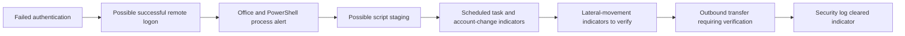

# SOC Incident Response Case Study

**SIMULATED / TABLETOP TRAINING CASE — not a real incident and not production SOC work.** This case applies practiced incident-response concepts to a hypothetical multi-stage alert scenario. No user-environment evidence or exact event values are represented.

## Case materials

- [Incident summary](incident-summary.md)
- [Timeline](timeline.md)
- [Triage](triage.md)
- [Scope analysis](scope-analysis.md)
- [Containment plan](containment.md)
- [MITRE ATT&CK mapping](mitre-mapping.md)
- [Final L1 handoff](final-incident-report.md)
- [Evidence handling note](evidence/README.md)

## Scenario flow

The arrows describe a tabletop hypothesis only. Validate each stage independently. A remote login, SMB activity, or outbound connection does not by itself establish compromise or exfiltration.

## Assessment language

Use **CONFIRMED**, **LIKELY**, **SUSPICIOUS**, **POSSIBLE**, and **REQUIRES VERIFICATION** as evidence-calibrated labels. This scenario begins with every proposed stage requiring verification.

## Training disclaimer

This is a simulated portfolio exercise for authorized training. It is not a report of production SOC employment, a real compromise, or a completed investigation. Do not substitute hypothetical details for actual evidence.
