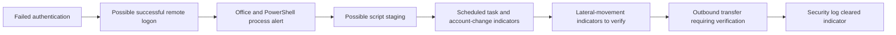

# SOC Incident Response Case Study

**SIMULATED / TABLETOP TRAINING CASE — not a real incident and not production SOC work.** This case applies incident-response concepts to a hypothetical multi-stage alert scenario. Every stage in the tabletop sequence remains unverified; no user-environment evidence is assigned to those stages. Separate local Splunk lab observations appear below and do not show that the hypothetical sequence occurred.

## Case materials

- [Incident summary](incident-summary.md)
- [Timeline](timeline.md)
- [Triage](triage.md)
- [Scope analysis](scope-analysis.md)
- [Containment plan](containment.md)
- [MITRE ATT&CK mapping](mitre-mapping.md)
- [Final L1 handoff](final-incident-report.md)
- [Evidence handling note](evidence/README.md)

## Scenario flow

The arrows describe a tabletop hypothesis only. Validate each stage independently. A remote login, SMB activity, or outbound connection does not by itself establish compromise or exfiltration.

## Assessment language

Use **CONFIRMED**, **LIKELY**, **SUSPICIOUS**, **POSSIBLE**, and **REQUIRES VERIFICATION** as evidence-calibrated labels. This scenario begins with every proposed stage requiring verification.

## Training disclaimer

This is a simulated portfolio exercise for authorized training. It is not a report of production SOC employment, a real compromise, or a completed investigation. Do not substitute hypothetical details for actual evidence.

## Splunk validation — local lab observations

The following genuine Splunk Enterprise screenshots were captured in the local lab on 2026-10-19. They document the displayed searches and results only. They do not validate or corroborate the hypothetical tabletop sequence above.

### Data available

The last-24-hour search showed 16,277 events: 15,077 from WinEventLog:Security, 770 from WinEventLog:System, and 430 from WinEventLog:Application. This confirms those sources returned events in that window, not complete collection or retention.

### Failed authentication and time analysis

The seven-day EventCode 4625 search returned 11 results from 2026-10-12 through 2026-10-19. Source aggregation showed 8 with 127.0.0.1 and 3 with a missing address. Account and host result fields are redacted. These results do not identify an external source or actor.

Daily counts for the same captured range were Oct 12: 0; Oct 13: 7; Oct 14: 1; Oct 15: 0; Oct 16: 1; Oct 17: 2; Oct 18: 0; Oct 19: 0, 2026. These are time-specific counts from the screenshot.

### Authentication correlation

A separate 30-day search showed 8 ten-minute result buckets containing both EventCode 4625 and 4624. The displayed buckets have a later success timestamp than failure timestamp, with visible source 127.0.0.1. This is bucket-level temporal co-occurrence, not proof of matched event pairs, sessions, compromise, or attribution.

### Sysmon PowerShell process context

The seven-day filtered search showed 8 rows after deduplication by command line. The process image is PowerShell; the displayed parent is the Wazuh agent. Visible commands query local account or security-policy settings. User and host fields are redacted. This is process telemetry, not evidence of malicious execution, and it is not correlated here to the authentication results.

### Evidence boundary

These captures do not show script staging, scheduled-task creation, account or group changes, lateral movement, confirmed data transfer or exfiltration, or Security log clearing. Those remain hypothetical investigation prompts and must not be reported as observed findings. Re-check Splunk before reusing the time-specific values above. The public screenshots redact host and account fields where present; keep sensitive originals and raw logs in an approved restricted location.
